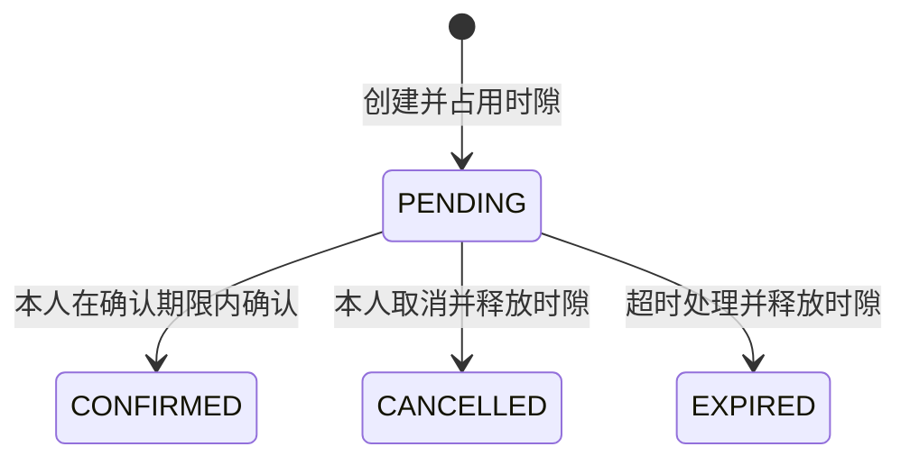

# ResQ 共享计算资源预约平台

ResQ 是面向 GPU、CPU 等共享计算资源的 Java 后端实习项目。用户可以查询资源和时隙，创建、确认或取消预约；系统处理预约竞争、重复请求、超时释放，并提供缓存查询与候补队列。

项目采用 Spring Boot 单体架构，通过 Docker Compose 统一管理应用、MySQL、Redis 和 RabbitMQ。提供真实 HTTP 演示脚本、隔离集成测试和历史性能实验报告，便于复现核心业务与解释实现取舍。

## 项目背景

实验室或团队共享计算资源时，常见问题包括：多人同时预约同一时隙、网络重试导致重复提交、待确认预约长期占用资源，以及查询量增加后数据库压力上升。

ResQ 围绕这些问题实现预约闭环：以 MySQL 保存业务状态，以事务和条件更新处理竞争，使用 Redis/Redisson 协调请求，再通过 RabbitMQ 与定时扫描释放超时预约。项目重点是业务正确性、工程可复现性和可解释的验证证据。

当前交付为后端 HTTP API 与命令行演示套件，没有正式前端或计算任务执行器；候补自动递补、真实邮件/短信通知等边界见文末说明。

## 核心功能

| 模块 | 当前实现 |
| --- | --- |
| 用户与鉴权 | 注册、BCrypt 密码校验、登录签发 JWT、查询本人资料；预约和候补接口校验身份 |
| 资源与时隙 | 资源列表、详情、创建，以及按资源/日期查询时隙；资源查询公开，创建需要 JWT |
| 预约流程 | 创建 PENDING 预约、本人确认、本人取消待确认预约、查询本人预约与历史游标分页 |
| 并发控制 | Redisson 时隙锁、MySQL 事务、AVAILABLE 条件更新；部分 Redis 连接故障有数据库兜底路径 |
| 请求幂等与限流 | `X-Request-Id`、Redis 请求状态、数据库唯一键及回查；Lua 按用户自然分钟限流，默认每分钟 10 次新预约请求 |
| 缓存 | 资源详情及日期时隙 Cache Aside、空值/空列表缓存、TTL 抖动、提交后失效与删除失败重试 |
| 消息与超时 | 提交后发送预约事件；TTL/死信触发超时处理、eventId 消费去重、有限重试及失败路由；定时扫描补偿过期预约 |
| 候补队列 | 已占用且未结束时隙的原子入队、重复入队去重、本人排名和队列规模查询 |
| 工程验证 | 四服务 Compose、健康检查、日志轮转、重启策略、隔离测试、动态种子与自动演示断言 |

## 技术栈

| 技术 | 版本/用途 |
| --- | --- |
| Java / Spring Boot | Java 21、Spring Boot 3.5.16；Web、参数校验、事务与 Actuator 健康检查 |
| MySQL | 8.0.46 / InnoDB；业务数据、条件更新、请求与消费去重记录 |
| MyBatis / JDBC | MyBatis Starter 3.0.5；预约、用户等 Mapper；资源路径保留 JdbcTemplate 实现 |
| Redis / Redisson | Redis 7、Redisson 4.8.0；缓存、分布式锁、Lua 限流、请求状态与候补有序集合 |
| RabbitMQ / Spring AMQP | RabbitMQ 3.13；预约事件、TTL/死信超时链路、消费确认与失败处理 |
| JWT / BCrypt | JJWT 0.13.0、Spring Security Crypto；令牌签发校验与密码哈希 |
| 构建与部署 | Maven、Docker、Docker Compose；Python 3 编排部署、隔离验收与演示 |
| 测试与性能分析 | JUnit 5、Mockito、MockMvc、真实中间件集成测试、k6、EXPLAIN ANALYZE、JVM Thread Dump |

## 核心实现

### 预约事务与状态流转

主请求按 Controller → Service → Mapper 分层。`ReservationLockService` 处理请求幂等、限流和时隙锁，`ReservationService` 管理预约事务；提交后的事件监听器负责发送 MQ 消息。

创建预约时，在同一数据库事务中通过条件 UPDATE 把 AVAILABLE 且尚未结束的时隙改为 RESERVED，再插入 PENDING 预约。影响行数不符则拒绝，插入失败则回滚时隙占用。并发正确性依赖事务与条件更新，Redisson 锁用于协调请求；数据库没有“每个 slot_id 只能保留一条历史预约”的唯一约束。



普通部署默认确认期限为 600 秒。确认、取消和过期处理使用状态条件更新；只有 PENDING 可以取消，不能先确认再取消同一条预约。重复取消不得释放后续新预约已占用的时隙。详见 [预约流程](docs/reservation-flow.md)。

### 请求幂等

创建预约携带 `Authorization: Bearer <JWT>` 与 `X-Request-Id`，请求体只需提供实际查询得到的 `slotId`。用户身份来自服务端 JWT 校验，客户端不指定 `userId` 或初始状态。

`X-Request-Id` 使用 `[A-Za-z0-9_-]{1,100}`，可由 UUID 生成。每次新的业务操作使用新 ID，同一次操作重试复用原 ID。

| 情况 | 处理方式 |
| --- | --- |
| 首次合法请求 | 创建预约 |
| 相同 ID、相同用户与时隙 | 返回原预约 |
| 相同 ID、不同用户或时隙 | 409 Conflict |
| 相同请求正在处理 | 503，提示稍后重试 |
| Redis 请求状态过期 | 通过 MySQL 记录回查 |

### 缓存与异步处理

资源详情和带 `date` 的时隙查询先读 Redis，未命中时查询 MySQL 并回填；不带日期的时隙查询不使用日期缓存。

| 缓存 | Key | 写入 TTL |
| --- | --- | --- |
| 资源详情 | `resource:{id}` | 300～360 秒，含随机抖动 |
| 不存在的资源 | `resource:{id}`，值为不存在标记 | 30 秒 |
| 日期时隙列表，含空列表 | `resource:{id}:slots:{date}` | 300～360 秒，含随机抖动 |

预约占用或释放时隙后，在事务提交后删除对应日期缓存，回滚不删。Redis 查询/回填失败时尽可能降级查库；缓存删除失败采用进程内重试和 TTL 恢复。缓存用于查询加速，预约结果仍由数据库事务判定。

预约超时通过 RabbitMQ 等待队列 TTL 与死信路由触发，消费者在事务中登记唯一 eventId 并尝试过期处理，重复事件不会再次完成业务变更。消费失败采用有限重试与失败队列，过期预约另有定时扫描补偿。发送端与数据库之间的可靠性边界见 [P0 修复说明](docs/p0-fixes.md) 和 [现状验收报告](docs/project-acceptance.md)。

## 部署与运行

以下命令在 Linux / WSL Ubuntu 的仓库根目录执行，需要 Java 21、Maven、Python 3，以及已启动的 Docker 和支持 `up --wait`、`config --format json` 的 Compose。

| 使用目的 | 入口 |
| --- | --- |
| 新机器正常部署，长期保存自己的业务数据 | 下方“全新环境部署”与 [部署说明](docs/deployment.md) |
| 自动准备资源/时隙并演示核心功能 | 下方“自动演示”与 [演示说明](docs/demo.md) |
| 本机已经初始化的常驻练习环境 | 使用 `scripts/practice.py`，见 [练习说明](docs/practice.md) |

**本机练习环境请继续使用 `python3 scripts/practice.py start`、`stop`、`status`。** 它的私有配置和数据卷独立于原 `deploy/.env`；混用下方普通部署命令可能切回旧环境。该本机配置不会随 Git clone 分发，`practice.py` 不是新机器初始化工具。

### 全新环境部署

先准备本地配置；已有 `.env` 时保留原文件，不用模板覆盖。

```bash
cp -n deploy/.env.example deploy/.env
chmod 600 deploy/.env
# 在本机编辑 deploy/.env，填好下述必填变量后再继续。
```

必填变量为 `MYSQL_ROOT_PASSWORD`、`RESQ_DB_USERNAME`、`RESQ_DB_PASSWORD`、`RESQ_RABBITMQ_USERNAME`、`RESQ_RABBITMQ_PASSWORD`、`RESQ_PROD_JWT_SECRET_BASE64` 和 `RESQ_APP_IMAGE`。JWT 签名密钥使用至少 32 字节随机值的 Base64 表示，镜像使用自己的版本标签。模板和变量说明见 [deploy/.env.example](deploy/.env.example) 与 [部署文档](docs/deployment.md)，密码和密钥只在本机保存。

```bash
# 构建 JAR 并运行默认测试；首次需要下载 Maven 依赖。
mvn clean package

# 构建应用镜像，等待依赖健康，配置超时失败路由，再启动应用。
python3 scripts/start_compose.py --env-file deploy/.env --build

# 检查健康与公开资源接口；若改了 RESQ_APP_PORT，同步修改这里的端口。
curl --fail http://127.0.0.1:8081/actuator/health
curl --fail http://127.0.0.1:8081/api/resources

# 查看四服务状态；停止时保留数据。
docker compose --env-file deploy/.env -p deploy -f deploy/compose.yaml ps
docker compose --env-file deploy/.env -p deploy -f deploy/compose.yaml stop
```

默认 HTTP 地址为 `http://127.0.0.1:8081`，容器内应用端口为 8080。MySQL/Redis/RabbitMQ 默认外部端口为 3306/6379/5672，MQ 管理界面为 15672，均绑定本机回环地址；Compose 通过服务名互相连接，并配置持久卷、健康检查、`unless-stopped` 与日志轮转。

MySQL 只在空数据卷首启时执行 [01-schema.sql](deploy/init/01-schema.sql)。普通部署只建表，不自动写演示资源/时隙，新库资源列表为空是正常结果；当前没有正式的创建时隙 HTTP 接口。要体验完整预约流程，使用下方独立演示环境。已有数据库的结构升级需要单独迁移，不能通过删卷重新初始化。

### 自动演示

准备阶段需要已有 Maven 依赖缓存，以及本地 `mysql:8.0.46`、`redis:7-alpine`、`rabbitmq:3.13-management`、`eclipse-temurin:21-jre-jammy` 镜像。首次先运行 `mvn clean package` 并准备这些镜像；演示准备使用离线 Maven，不自动拉取镜像。

```bash
python3 scripts/demo/prepare.py
python3 scripts/demo/run.py status
python3 scripts/demo/run.py all
python3 scripts/demo/run.py cleanup
```

`prepare` 新建独立项目、网络、数据卷与合成凭据，生成 GPU/CPU 两个资源和八个未来时隙，并准备并发用户。`all` 通过真实 HTTP、SQL、Redis 和 MQ 断言验证基础预约、50 用户竞争、请求幂等、超时释放、消费者去重、缓存重建与候补排名；任意断言失败均返回非零退出码，输出脱敏报告。

讲解时可用 `basic` → `concurrency` → `advanced` 三条命令替代 `all`。演示环境使用 60 秒确认期限并匹配 MQ TTL，普通部署仍为 600 秒。同一 session 的写场景只执行一次，重复演示应重新 prepare；cleanup 仅清理归属校验通过的本次演示资源。使用方式、故障证据范围和主持人提纲见 [演示文档](docs/demo.md)。v1.0 指演示套件，不代表已发布应用 Git Release。

## 主要 HTTP API

JWT 接口使用 `Authorization: Bearer <token>`；登录响应包含 `token` 与 `tokenType`。无公开默认账号，用户自行注册；自动演示会注册合成账号并在内存中使用 Token，不输出密码或令牌。

| 方法 | 路径 | 用途 | JWT |
| --- | --- | --- | --- |
| POST | `/api/auth/register` | 注册 | 否 |
| POST | `/api/auth/login` | 登录获取 JWT | 否 |
| GET | `/api/users/me` | 本人资料 | 是 |
| GET | `/api/resources` | 资源列表 | 否 |
| GET | `/api/resources/{id}` | 资源详情 | 否 |
| GET | `/api/resources/{id}/slots?date=yyyy-MM-dd` | 时隙列表，date 可省略 | 否 |
| POST | `/api/resources` | 创建资源 | 是 |
| POST | `/api/reservations` | 创建预约，另需 `X-Request-Id` | 是 |
| GET | `/api/reservations/me` | 本人全部预约 | 是 |
| GET | `/api/reservations/me/page` | 本人预约游标分页 | 是 |
| GET | `/api/reservations/{id}` | 本人预约详情 | 是 |
| POST | `/api/reservations/{id}/confirm` | 确认本人待确认预约 | 是 |
| DELETE | `/api/reservations/{id}` | 取消本人待确认预约 | 是 |
| POST / GET | `/api/slots/{slotId}/waitlist` | 加入候补 / 查询本人排名及队列规模 | 是 |
| GET | `/actuator/health` | 服务健康检查 | 否 |

游标分页 `size` 默认 20、范围 1～100；下一页同时携带 `cursorCreatedAt` 和 `cursorId`，按 `(created_at, id)` 倒序查询。资源创建目前仅要求登录，没有管理员角色分级。

## 构建、测试与验收入口

| 命令 | 验证范围 |
| --- | --- |
| `mvn clean package` | 编译全部测试源码，执行不依赖中间件的单元/MVC 测试并生成 JAR；当前基线 102 项 |
| `python3 scripts/run_integration_tests.py` | 独立 MySQL/Redis/RabbitMQ 下的完整集成验收；29 项加专用 8 项，要求 37 项全部通过、无跳过 |
| `python3 scripts/run_p0_integration_tests.py` | 单独复现预约时间边界 7 项、MQ 失败路由 1 项 |
| `python3 scripts/verify_compose_deployment.py` | 构建镜像、全新四服务启动、HTTP 业务、异常退出重启和重建后持久化验收 |
| `python3 scripts/verify_demo_seed.py` | 临时 MySQL 中验证种子、失败回滚及重复导入拒绝 |
| `python3 scripts/demo/test_demo.py` | 演示工具的离线保护测试，不操作 Docker |

集成入口使用已有镜像与 Maven 缓存，新建专属容器、随机合成凭据和隔离标记，不借用现有开发数据库。部署验收也使用独立项目与新卷，并按归属清理；端口冲突时拒绝运行。具体前提、专用端口和报告解释见 [测试说明](docs/testing.md)、[部署说明](docs/deployment.md)。

默认构建不依赖 `-DskipTests` 或 `-Dmaven.test.skip=true`；直接执行 `mvn -Pintegration test` 不会创建隔离依赖或初始化保护标记，应使用脚本入口。测试统计代表各入口的范围，不把不同入口的数字相加当作独立业务覆盖量。

默认报告位于 `target/surefire-reports/`，其他验收汇总分别位于 `target/integration-results/`、`target/p0-integration-results/`、`target/compose-acceptance/` 和 `target/demo-seed-results/`。`mvn clean` 会删除这些产物，需要的证据应先另行归档；演示 session 报告位于仓库外私有目录，见演示文档。

## 性能实验与证据

以下为 2026-10-21～22 的历史受控实验，不代表当前版本的最大吞吐量或生产容量。本轮 README 整理未重新压测。

| 实验 | 已记录结果与适用范围 |
| --- | --- |
| [GET 时隙查询](benchmarks/resource-slot-query-report.md) | 200 VU、带 `sleep(1)` 的 30 秒测试，6,000 次请求无 HTTP 失败，P99 24.25 ms；请求节奏受脚本限制 |
| [预约并发竞争](benchmarks/reservation-concurrency-report.md) | 50/100/200 用户各一次单时隙竞争，每档 1 个创建成功，其余为已核实的库存冲突，SQL 最终有效预约数均为 1 |
| [Redis 缓存对照](benchmarks/redis-cache-report.md) | 热命中相对首次 miss 回源/回填，三档平均延迟降低约 36%～41%；不是关闭 Redis 的对照，也不保证每项长尾指标都改善 |
| [游标分页](docs/performance/reservation-pagination-benchmark.md) | 10 万行模拟数据、返回 20 个 ID 的独立实验，扫描量由 50,020 降至 20；不直接等同完整 HTTP 接口耗时 |

报告包含方法、限制和原始证据入口，性能异常排查保留了 JVM 线程快照中的日志输出竞争线索。原始日志/指标压缩包及恢复方法见 [证据归档](benchmarks/archives/README.md)。

## 项目结构

```text
resq/
├── src/main/java/com/resq/
│   ├── controller/          # HTTP 入口
│   ├── service/             # 业务、事务、JWT、限流与候补
│   ├── mapper/              # MyBatis 与 JDBC 数据访问
│   ├── domain/ dto/ vo/     # 实体、请求参数与响应对象
│   ├── cache/               # 缓存、请求状态与缓存失效
│   ├── config/ exception/  # 配置、鉴权与异常响应
│   └── event/ mq/ scheduler/ # 业务事件、消息与补偿扫描
├── src/main/resources/      # Profile、Mapper XML、Lua
├── src/test/java/           # 单元、MVC 与隔离集成测试
├── deploy/                  # Compose、环境变量模板、初始化 SQL
├── scripts/                 # 启动、种子、验收；demo/ 为统一演示
├── benchmarks/              # 正式性能报告、摘要与证据归档
├── docs/                    # 设计、部署、测试与验收说明
├── Dockerfile
└── pom.xml
```

## 实现边界与后续改进

- 候补目前支持入队、去重和排名，尚无取消/超时后的自动递补；通知消费者仅记录日志，尚无真实邮件或短信。
- MQ 事件在数据库提交后发送，尚无持久化补发/outbox 或完整的 Publisher Confirm/Return 处理闭环；超时扫描不能补回所有通知消息。
- Cache Aside 存在并发旧读回填与短暂不一致窗口，失效重试队列不能跨进程恢复；TTL 含抖动，不能宣传强一致查询。
- 新库只有表结构；演示种子仅面向全新隔离环境，不向已有库重复补种、覆盖或重置数据。时隙会随时间自然到期。
- 当前无管理员角色分级、完整任务执行调度或生产容量保证。后续优先补候补边界/消息发送失败测试，再按业务需要评估权限、可靠投递与数据库迁移。

详细现状、各阶段验证与待办见 [项目验收报告](docs/project-acceptance.md)。该文保留历史快照与后续补充，旧统计应结合对应阶段阅读；本机容器当前状态使用运行入口实时查询。

## 文档导航

| 内容 | 文档 |
| --- | --- |
| 环境变量、四服务部署、启停与隔离验收 | [部署说明](docs/deployment.md) |
| 测试分组、隔离保护与异常契约 | [测试说明](docs/testing.md) |
| 原生 MySQL/Redis 并发与事务测试 | [原生预约测试](docs/native-reservation-testing.md) |
| 预约事务、状态变化与缓存失效 | [预约流程](docs/reservation-flow.md) |
| MyBatis/JDBC 分工与保留的学习 Mapper | [映射说明](docs/mybatis-mapping.md) |
| 权限、时间边界与 MQ 失败路由 | [P0 修复与验证](docs/p0-fixes.md) |
| SQL 索引设计 | [索引设计](docs/performance/resq-index-design.md) |
| 预约分页性能与实验限制 | [分页基准测试](docs/performance/reservation-pagination-benchmark.md) |
| 三项压测报告与原始证据入口 | [性能报告导航](benchmarks/README.md) |
| 时隙查询 / 预约竞争 / Redis 对照 | [查询](benchmarks/resource-slot-query-report.md) · [预约](benchmarks/reservation-concurrency-report.md) · [缓存](benchmarks/redis-cache-report.md) |
| 原始证据 ZIP 与恢复方法 | [证据归档](benchmarks/archives/README.md) |
| 本地学习归档分类与恢复索引 | [学习资料索引](docs/learning-archive.md) |
| 本机常驻练习、配置与回退 | [练习说明](docs/practice.md) |
| v1.0 自动演示与讲解提纲 | [演示说明](docs/demo.md) |
| 演示实测、失败记录与限制 | [演示验收](docs/demo-acceptance.md) |
| 全新演示库种子及保护约束 | [种子说明](docs/demo-seed.md) |
| 统一演示的原始方案评估 | [设计记录](docs/demo-system-plan.md) |
| 项目现状、阶段性验收与改进建议 | [项目验收](docs/project-acceptance.md) |

独立学习材料位于本地 `learning-archive/`，不进入 Git 或 Docker 镜像。旧总汇 `benchmarks/benchmarks.md` 及 results/ 下三份 Day24 Markdown 快照也仅保留本地；新克隆以正式报告和 ZIP 证据为准。真实 `.env`、密码、JWT 密钥、Token 与私有运行日志不作为公开交付资料。
